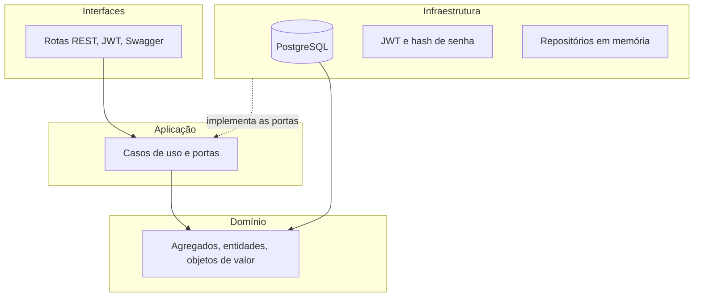
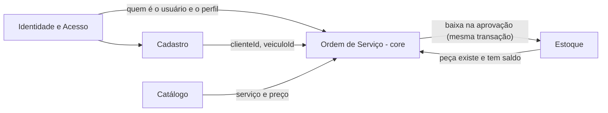
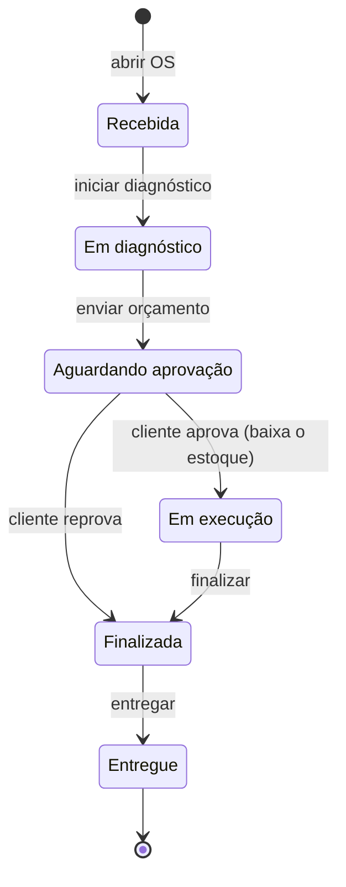
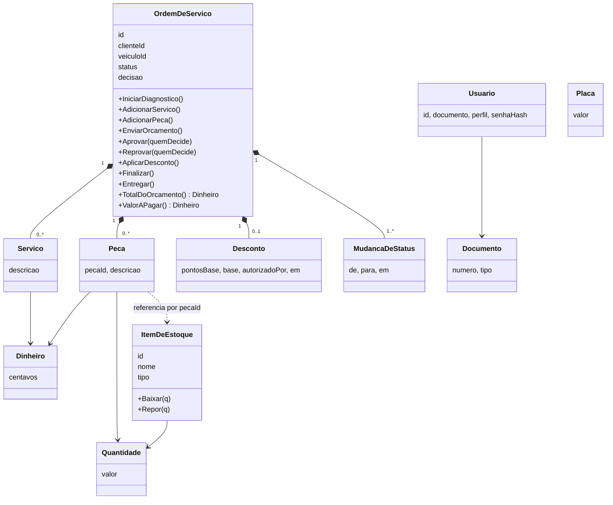
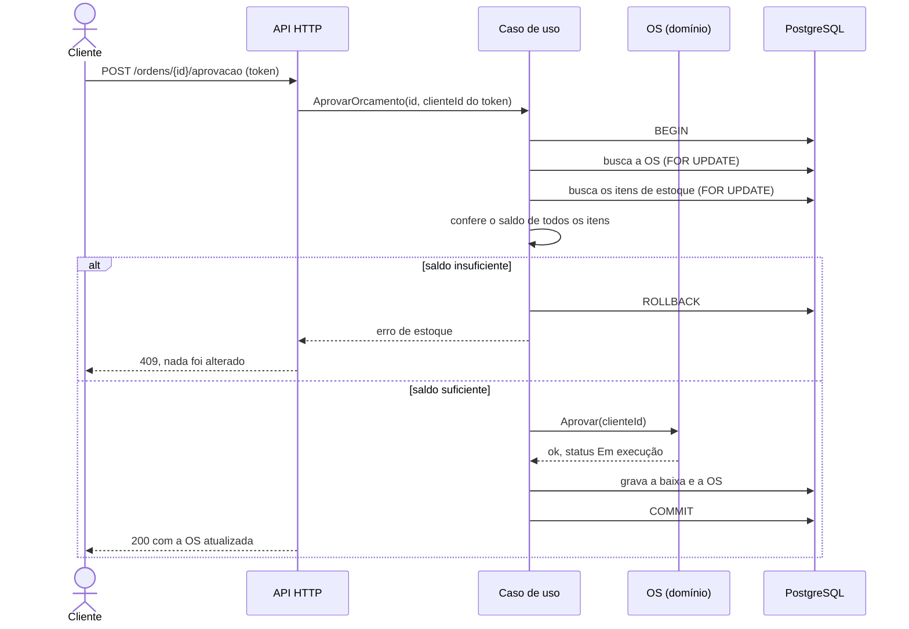
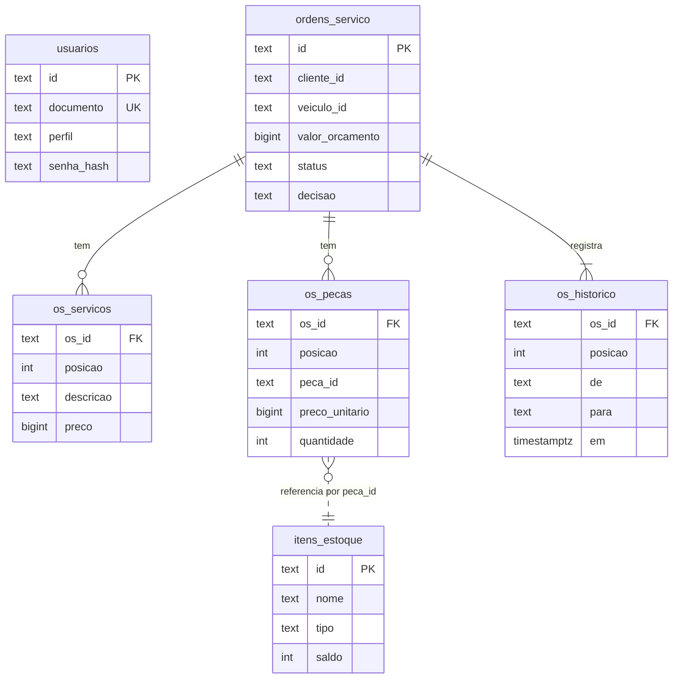

# Diagramas

## 1. Arquitetura em camadas

O domínio não depende de nenhuma outra camada. As portas (repositórios, transação, relógio, autorizador do gerente) são interfaces da camada de aplicação, implementadas na infraestrutura.

## 2. Mapa de contextos

| Relação | Tipo | Como funciona |
|---|---|---|
| Cadastro → Ordem de Serviço | Fornecedor e cliente | A OS guarda só `clienteId` e `veiculoId` |
| Catálogo → Ordem de Serviço | Fornecedor e cliente | A OS guarda a descrição e o preço do serviço no momento da inclusão |
| Ordem de Serviço ↔ Estoque | Parceria, coordenada pela camada de aplicação | A aprovação confere e baixa o saldo numa única transação |
| Identidade e Acesso → demais | Conformista | Os demais aceitam o perfil e o cliente que vêm do token |

Um contexto não altera os dados de outro diretamente: a coordenação acontece nos casos de uso (ADR 0003).

## 3. Máquina de estados da OS

## 4. Agregados e objetos de valor

## 5. Sequência: aprovação do orçamento com baixa de estoque (RN06, RN09)

## 6. Modelo de dados

Dinheiro em `BIGINT` de centavos. O saldo do estoque tem `CHECK (saldo >= 0)`, a última defesa contra saldo negativo.
