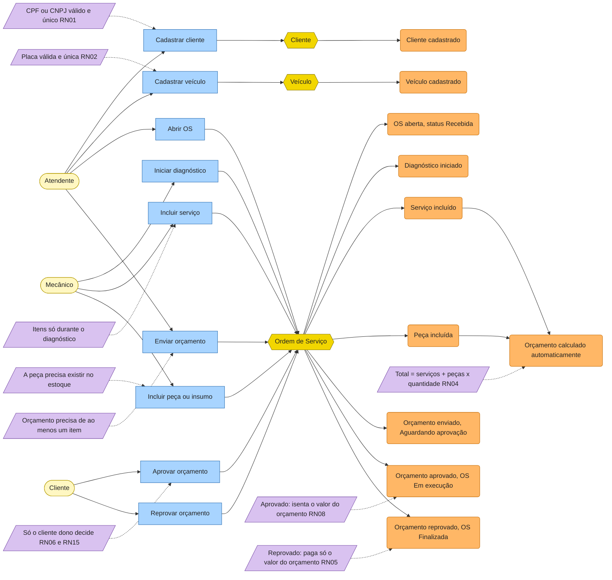
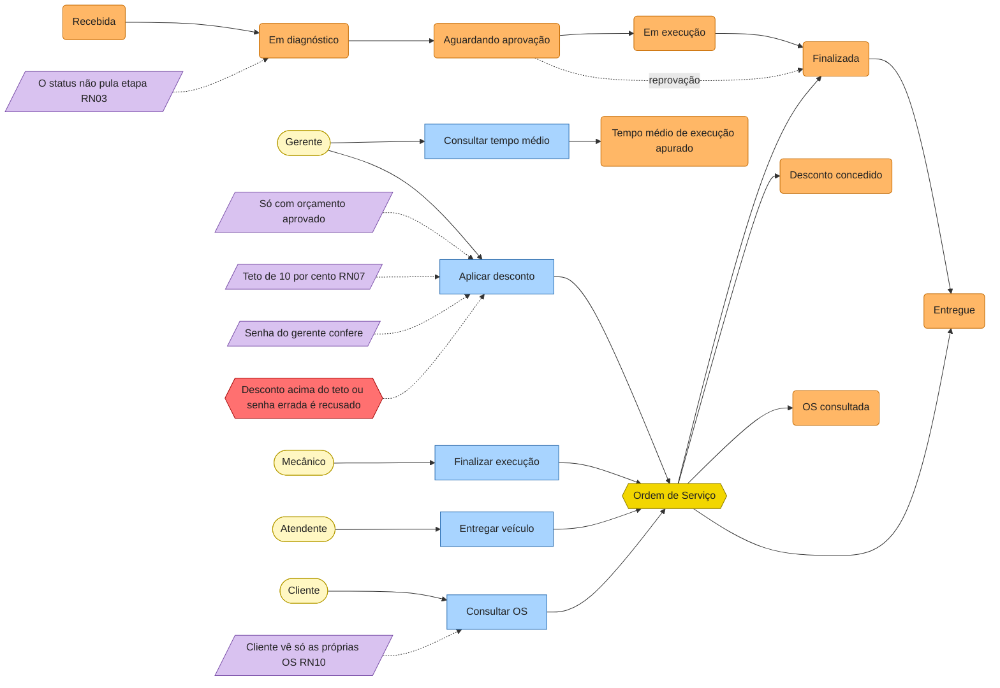
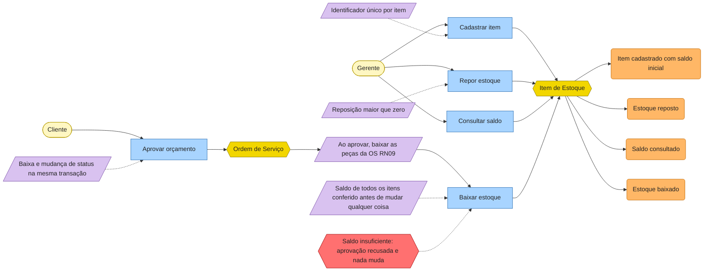

# Event Storming

Resultado do Event Storming do domínio da oficina, em três fluxos. Cores usadas, como na aula:

| Cor | Elemento |
|---|---|
| Laranja | Evento de domínio (verbo no passado) |
| Azul | Comando (a intenção de um ator) |
| Amarelo claro | Ator |
| Amarelo escuro | Agregado |
| Lilás | Política ou regra de negócio |
| Rosa | Sistema externo |
| Vermelho | Ponto de atenção (hot spot) |

## Atores

| Ator | Papel |
|---|---|
| Cliente | Dono do veículo; acompanha a OS e aprova ou reprova o orçamento |
| Atendente | Cadastra clientes e veículos, abre a OS, envia o orçamento, entrega o veículo |
| Mecânico | Faz o diagnóstico, inclui serviços e peças, finaliza a execução |
| Gerente | Aplica desconto, cadastra funcionários, gerencia estoque, vê o tempo médio |
| Administrador | RH ou dono; cadastra funcionários |
| Serviço de e-mail (externo) | Entregaria o link de primeiro acesso (RN11 e RN13); fora do MVP entregue |

## Fluxo 1 — Criação da Ordem de Serviço

**Primeiro acesso por e-mail (RN11 e RN13):** foi modelado no Event Storming e está nas regras de negócio, mas **não faz parte do MVP entregue**. No MVP o cliente e o funcionário entram com CPF e senha de usuários criados pela inicialização (administrador e usuários de demonstração). O fluxo previsto é: o atendente cadastra o cliente, o sistema envia um link de uso único (sistema externo, rosa), e o cliente define a senha pela política da RN12.

**Pontos de atenção**

- A reprovação não passa por execução: a OS vai de Aguardando aprovação direto para Finalizada.
- Um funcionário nunca decide pelo cliente, mesmo o Administrador (RN15).

## Fluxo 2 — Acompanhamento da Ordem de Serviço

**Pontos de atenção**

- O desconto não pode ser aplicado duas vezes na mesma OS.
- O tempo médio considera só as OS que já passaram por Em execução e saíram dela.

## Fluxo 3 — Gestão de peças e insumos

**Pontos de atenção**

- Duas aprovações ao mesmo tempo disputando a última unidade: o banco trava a linha do item (`SELECT ... FOR UPDATE`) e só uma aprova.
- Peça repetida na mesma OS é somada antes de conferir o saldo.

## Eventos de domínio

| Evento | Quem causa | Contexto |
|---|---|---|
| Cliente cadastrado | Atendente | Cadastro |
| Veículo cadastrado | Atendente | Cadastro |
| OS aberta | Atendente | Ordem de Serviço |
| Diagnóstico iniciado | Mecânico | Ordem de Serviço |
| Serviço incluído | Mecânico | Ordem de Serviço |
| Peça incluída | Mecânico | Ordem de Serviço |
| Orçamento calculado | Sistema | Ordem de Serviço |
| Orçamento enviado | Atendente | Ordem de Serviço |
| Orçamento aprovado | Cliente | Ordem de Serviço |
| Orçamento reprovado | Cliente | Ordem de Serviço |
| Estoque baixado | Sistema, na aprovação | Estoque |
| Desconto concedido | Gerente | Ordem de Serviço |
| Execução finalizada | Mecânico | Ordem de Serviço |
| Veículo entregue | Atendente | Ordem de Serviço |
| Item de estoque cadastrado | Gerente | Estoque |
| Estoque reposto | Gerente | Estoque |

No MVP os eventos não circulam por um barramento. Eles ficam registrados no próprio agregado: cada mudança de status entra no histórico da OS (de, para, quando), e a decisão do cliente guarda quem decidiu e quando. A evolução para microsserviços pode transformá-los em mensagens.

## Comandos

| Comando | Ator | Endpoint |
|---|---|---|
| Cadastrar cliente | Atendente | `POST /clientes` |
| Cadastrar veículo | Atendente | `POST /veiculos` |
| Abrir OS | Atendente | `POST /ordens` |
| Iniciar diagnóstico | Mecânico | `POST /ordens/{id}/diagnostico` |
| Incluir serviço | Mecânico | `POST /ordens/{id}/servicos` |
| Incluir peça ou insumo | Mecânico | `POST /ordens/{id}/pecas` |
| Enviar orçamento | Atendente | `POST /ordens/{id}/orcamento` |
| Aprovar orçamento | Cliente | `POST /ordens/{id}/aprovacao` |
| Reprovar orçamento | Cliente | `POST /ordens/{id}/reprovacao` |
| Aplicar desconto | Gerente | `POST /ordens/{id}/desconto` |
| Finalizar execução | Mecânico | `POST /ordens/{id}/finalizacao` |
| Entregar veículo | Atendente | `POST /ordens/{id}/entrega` |
| Consultar OS | Cliente ou funcionário | `GET /ordens/{id}`, `GET /ordens` |
| Consultar tempo médio | Gerente | `GET /relatorios/tempo-medio-execucao` |
| Cadastrar serviço no catálogo | Gerente | `POST /servicos` (e `PUT`, `DELETE`, `GET`) |
| Cadastrar item de estoque | Gerente | `POST /estoque` |
| Repor estoque | Gerente | `POST /estoque/{id}/reposicao` |
| Consultar saldo | Funcionário | `GET /estoque/{id}` |

## Políticas e regras de negócio

| Política | Regra |
|---|---|
| CPF ou CNPJ válido e único | RN01 |
| Placa válida e única | RN02 |
| O status segue a ordem e não pula etapa | RN03 |
| Orçamento calculado automaticamente | RN04 |
| Cobrança conforme a decisão do cliente | RN05 |
| Só o cliente dono decide | RN06 e RN15 |
| Desconto de até 10%, com orçamento aprovado e senha do gerente | RN07 |
| Isenção do valor do orçamento na aprovação | RN08 |
| Baixa de estoque na aprovação, na mesma transação, sem saldo negativo | RN09 |
| Cliente só vê as próprias OS | RN10 |
| Cadastro no balcão (implementado) e primeiro acesso por e-mail (modelado, fora do MVP entregue) | RN11 e RN13 |
| Senha forte, guardada só como hash | RN12 |
| O primeiro Administrador nasce na inicialização (implementado); o cadastro de funcionários pela API fica fora do MVP entregue | RN14 |

Texto completo de cada regra em [`../requisitos/escopo-e-regras-de-negocio.md`](../requisitos/escopo-e-regras-de-negocio.md).

## Agregados, entidades e objetos de valor

| Agregado (raiz) | Entidades internas | Objetos de valor |
|---|---|---|
| **Ordem de Serviço** | Serviço, Peça, Desconto, Mudança de status | Dinheiro, Quantidade, Status, Decisão, Base do desconto |
| **Item de Estoque** | — | Quantidade, Tipo (Peça ou Insumo) |
| **Cliente** | — | Documento (CPF ou CNPJ) |
| **Veículo** | — | Placa |
| **Usuário** | — | Documento, Perfil |
| **Serviço do catálogo** | — | Dinheiro |

Regra de consistência: tudo o que muda a OS passa pelos métodos da raiz, que garantem as regras. A OS referencia cliente, veículo e peças só por identificador.

## Contextos delimitados

| Contexto | Responsabilidade | Agregados |
|---|---|---|
| **Ordem de Serviço** (core) | O ciclo da OS, orçamento, decisão, desconto | Ordem de Serviço |
| **Cadastro** | Quem é o cliente e qual é o veículo | Cliente, Veículo |
| **Catálogo** | Serviços oferecidos e seus preços | Serviço do catálogo |
| **Estoque** | Peças e insumos, saldo, reposição e baixa | Item de Estoque |
| **Identidade e Acesso** | Login, perfis, senha | Usuário |

O mapa de contexto está em [`diagramas.md`](diagramas.md).
